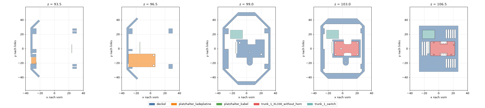

# Deckel v3 (trunk_top) – Kabelweg für die Kopfkamera (18.11.2026)

Quelle: `v3/cad/deckel.py`. Grundlage ist der Original-Deckel aus `cad/microban.step`, geändert werden nur zwei Stellen.
Neu erzeugen: `uv run --no-project --python 3.12 --with build123d python v3/cad/deckel.py`

## Änderungen

1. **Kabelschlitz hinter dem Kopfmotor:** x −16,5 … −12,7, y −7 … 10, durch die Deckplatte und die Rückwand der
   Motortasche. Vorn bleibt 1 mm Wand zur hinteren Motorschraube. Der Motor wird von seinen 2 Schrauben gehalten.
2. **Ladeplatine 4 mm nach rechts:** Neue USB-C-Öffnung in der Rückwand, die alte ist zu, links eine neue Haltenase. Im
   rechten Schraubendom gibt es eine flache Tasche für den Platinenrand. Die Dom-Schraube (z 85,8) bleibt unberührt.

Druckdatei `v3/cad/stl/deckel.stl` liegt wie das Original `cad/stl/trunk_top.stl`. Stützmaterial ist fast gleich
(1.247 statt 1.212 mm²).

## Kabelweg Kamera → Pi Zero 2 W

Kopf (Schlitz in `kopf_basis`) → senkrecht hinter dem Kopfmotor durch den Deckelschlitz → unter dem Deckel bei z ≈ 94
waagerecht nach vorn (über Akku und BMS, unter der Motorhalterung) → am Pi von oben in den Kameraanschluss.

**Wichtig:** Den Pi Zero 2 W mit der Pollen-Platine **um 180° gedreht** einbauen (SD-Karte unten, Kameraanschluss oben).
Das Lochbild ist symmetrisch. Danach prüfen, ob die Motorkabel an der Pollen-Platine noch passen (die Stecker liegen
dann am anderen Ende).

Kabel: das 22-polige Kabel aus dem AI-Camera-Set (für Pi 5/Zero, 200 mm). Der Weg ist ca. 130 mm lang.

## Geprüft (`v3/tools/teile_pruefen.py`)

- Kabel-Platzhalter (0,3 mm dick) vom Kopf bis zum Pi: frei gegen alle Teile inkl. neuem Kopf und Deckel.
- Ladeplatine an der neuen Stelle: frei.
- Neuer Deckel: nur die 4 Schrauben in ihren Löchern (wie beim Original).

## Offen

- Der Kameraanschluss des Pi Zero ist im 3D-Modell der Baugruppe nicht enthalten. Das letzte Stück Kabel ist darum nur
  ungefähr geprüft.
- Kabel festlegen: kleine Kabelführung bzw. Klebepad unter dem Deckel, damit das Kabel nicht an den Akku rutscht.
