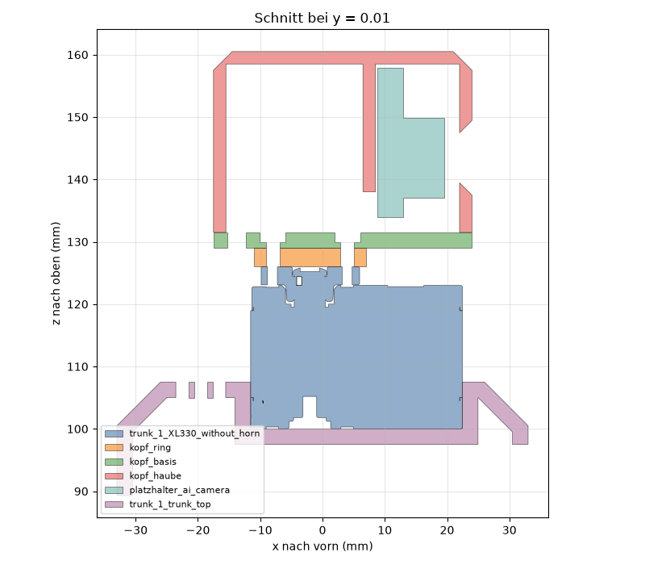

# Kopf v0.1 mit Raspberry Pi AI Camera (18.11.2026)

Quelle: `v3/cad/kopf.py` (build123d). Neu erzeugen:
`uv run --no-project --python 3.12 --with build123d python v3/cad/kopf.py`

## Teile

| Teil | Drucken | Gewicht (Schätzung, 15 % Füllung) | Stützmaterial |
|---|---|---|---|
| `kopf_ring` – Distanzring ø18 × 3 | flach | 0,8 g | keins |
| `kopf_basis` – Bodenplatte | flach, Platte unten | 5,5 g | praktisch keins (15 mm²) |
| `kopf_haube` – Haube mit Kamerahalter | kopfüber, Dach unten | 16 g | wenig (321 mm², alter Kopf: 586 mm²) |

Drucklage: `v3/cad/stl/`, Einbaulage (zum Prüfen): `v3/cad/einbau/`, CAD: `v3/cad/step/`.
Zum Vergleich der alte Kopf: ca. 15 g. Neu kommen ca. 22 g PLA plus die Kamera dazu.

## Zusammenbau

1. Distanzring und Bodenplatte mit **4 × M2x8** (STP39, wie die Motorschrauben) auf den Abtrieb des Kopfmotors
   (ID 51). Der Kopf ist dabei noch offen, die Schrauben sind gut erreichbar.
2. AI Camera mit **4 × M2x6** an die Bolzen in der Haube schrauben, Objektiv nach vorn, Kabel nach unten.
3. Kabel unten an der Kamera nach hinten umbiegen (nicht knicken), über die Bodenplatte nach hinten legen und durch
   den Schlitz hinter dem Motor nach unten führen.
4. Haube aufsetzen, links und rechts je **1 × M2x6** in die Laschen der Bodenplatte schrauben.

## Geprüft

- Mit `v3/tools/kopf_pruefen.py`: Bei Kopfdrehung **−60° … +60°** (genutzt werden ±46°) stößt nichts an Motor,
  Deckel, Schalter oder Schultern.
- Die Kamera passt in die Haube. Überschneidung gibt es nur an den 4 Abstandsbolzen, weil der Platzhalter die
  Rückseite der Kamera als vollen Quader annimmt. Zwischen Objektiv und Fenster bleiben 2,4 mm.
- Sichtfenster: innen ø8, außen ø12, kegelig für 66° × 52° Blickwinkel.
- Lochbild Horn: 4 Löcher auf 6 mm Radius um die Drehachse (x = −2, y = 0), genau wie der alte Kopf.

## Offen

- **Maße der AI Camera am echten Teil nachmessen:** Tiefe der Bauteile auf der Rückseite (angenommen 3,2 mm), Größe des
  Objektivblocks, Lage des Kabelanschlusses. Die Werte stehen oben in `kopf.py` und lassen sich einfach anpassen.
- **Kabelweg im Rumpf:** Hinter dem Motor liegt heute `trunk_top` (Rahmen um den Motor). Dort braucht der neue Deckel
  einen Schlitz und Platz für eine Kabelschlaufe. Ladeplatine und Schalter liegen in der Nähe → beim Umbau von
  `trunk_top` mit einplanen.
- **Gewicht:** Der Kopf wird ca. 10–15 g schwerer (Kamera + Haube). Für Simulator und Laufmodell die Masse im Modell
  (`microban_model`) anpassen und `walk` im Simulator testen.
- Erster Probedruck: Passt der Distanzring auf den Abtrieb? Halten die Schrauben in den Laschen?
